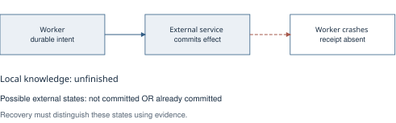
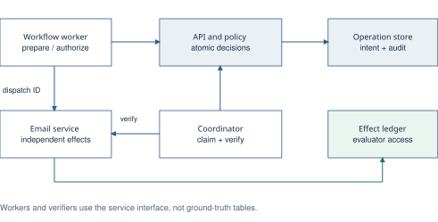
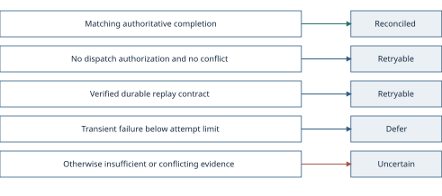
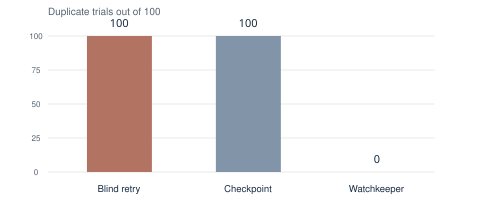

# Watchkeeper Final Project Report

Evidence driven recovery for interrupted tool using workflows

**Aditya Srivastava 24BCE0511 · Anshith Bhandary 24BCE0429 · Ananta Bose 24BCB0087**

School of Computer Science and Engineering, Vellore Institute of Technology, Vellore

Final implementation and evaluation report · 30 October 2026

**GitHub repository:** [github.com/jerkeyray/watchkeeper](https://github.com/jerkeyray/watchkeeper)

## Executive summary

Watchkeeper is an implemented recovery layer for the gap between an external action happening and a workflow durably recording its result. If a tool sends an email and its worker crashes before saving confirmation, replay can send a duplicate. If the request never arrived, skipping it can leave the task incomplete. The same missing local receipt is compatible with both situations.

The system records durable intent, binds the operation to a stable identity, grants dispatch authorization once per attempt, and verifies unresolved effects before selecting a recovery action. A matching authoritative observation permits reconciliation. Proven non-dispatch or a verified durable idempotency contract permits another attempt. Insufficient or contradictory evidence produces an auditable Uncertain state and stops automatic dispatch.

The implementation uses Go, PostgreSQL, a versioned HTTP API, a recovery coordinator, service-specific evidence adapters, and an independently persisted email simulator. Its AI interpretation is a knowledge-based agent that observes a partially visible environment and applies explicit action-selection rules. The current implementation contains no trained model, LLM planner, probabilistic belief-state solver, or learned recovery policy.

The retained email evaluation contains 15,900 valid executions across 159 supported configurations, plus 6,500 explicitly unsupported combinations. Under a crash after external commit with status evidence, Watchkeeper completed 100/100 workflows with 0/100 duplicate-effect trials. With no recovery evidence, it produced 0/100 duplicates but stopped uncertain in 100/100 trials, completing none of those workflows. A separate clean-path dataset measured a median of 18.59 ms for Watchkeeper versus 4.58 ms for blind retry. These results establish a conditional recovery tradeoff in a controlled prototype, not universal exactly-once execution.

This document describes the completed artifact, its design choices, comparative contribution, measured results, operational instructions, and remaining limitations. The repository includes compressed raw records, manifests, summaries, and representative decision traces supporting the report.

[TOC]

## 1 Problem and project scope

### 1.1 The uncertain completion window

A local database transaction can atomically save workflow state. It cannot normally include an unrelated service operated behind its own API. Consider the sequence: persist an email intent, authorize dispatch, send the request, let the service commit, and save the receipt. A crash between external commit and receipt persistence leaves the external world ahead of local knowledge.

A timeout does not identify which event failed. The request may never have arrived, the service may still be executing it, or the service may have completed it while the response disappeared. Recovery therefore needs more than an instruction to repeat the last step. It needs a justified account of what the earlier operation did.



Skipping an unresolved operation is also insufficient. If the first request never committed, the intended effect remains absent. Compensation is a separate business action and may be unavailable or irreversible. For example, a second email cannot erase the first email from a recipient's inbox.

### 1.2 Supported scope

Watchkeeper implements sequential email workflows against a simulator with independently committed effects. It supports normal execution, restart and continuation, guarded dispatch, verification, uncertainty, manual resolution, four service capability profiles, and comparative process-crash experiments. The benchmark uses three logical email actions and targets the second action so that replay of previously completed work is visible.

Calendar operations, inventory reservations, payments, and external record transitions illustrate the problem but are not implemented or evaluated workloads. Kubernetes pod failures, whole-host failures, production provider adapters, business compensation, and end-to-end LLM task planning are outside the current result.

### 1.3 Project objectives

The implemented objectives are to persist intent before dispatch, preserve one identity across attempts, prevent compliant workers from independently acquiring duplicate send permission, reconcile positive external evidence, preserve uncertainty when evidence is inadequate, and expose an ordered explanation of each recovery decision. The evaluation measures both safety and task completion so that abstention cannot be mistaken for successful recovery.

## 2 Contribution and comparison with existing systems

### 2.1 The implemented contribution

The contribution is the integration of an explicit external-effect recovery protocol with an auditable decision model and a reproducible failure harness. The individual building blocks, including write-ahead intent, idempotency, optimistic versions, leases, and durable histories, are established techniques. This project does not claim a new consensus algorithm or establish literature-wide priority for those mechanisms.

Watchkeeper makes three distinctions explicit. Preparation is different from permission to send. An observation is different from a decision. Successful recovery is different from refusing to make an unjustified claim. These distinctions allow the system to explain why it reconciled, permitted retry, deferred verification, or stopped uncertain.

### 2.2 Position against related systems

The following comparison concerns design scope. Beldi, Netherite, ExoFlow, and saga mechanisms were not deployed as benchmark competitors. Their descriptions provide context from the related work identified in the initial project document [1-4]. The measured comparisons in Section 9 use separately implemented baselines in this repository.

| Approach | Main design emphasis | Position of Watchkeeper |
| --- | --- | --- |
| Beldi [1] | Fault-tolerant transactional stateful serverless workflows within its supported execution and state model | Targets a remote side effect outside the local transaction boundary and resolves it through the evidence that the service exposes |
| Netherite [2] | Efficient durable execution of serverless workflows | Concentrates on the unresolved external action rather than workflow scheduling or event-processing throughput |
| ExoFlow [3] | Workflow execution with configurable recovery and performance tradeoffs | Adds a narrow, service-aware decision for an action whose external completion is ambiguous |
| Sagas [4] | Coordinated sequences of business actions with compensating actions | Verifies the original effect before selecting a recovery action and does not implement generic business compensation |
| Durable idempotency keys | Bind a stable key to a request and deduplicate repeats at the service | Uses this as a sufficient safe-replay capability when available, alongside status and indirect evidence |
| Checkpoint recovery | Preserve acknowledged local progress and resume the first incomplete step | Resolves the in-flight external effect that a checkpoint alone cannot establish |

This positioning does not imply that an existing engine cannot host equivalent application logic. Watchkeeper is complementary to durable execution: it makes effect identity, evidence classification, authorization, and abstention explicit in one reusable prototype. It has not demonstrated a performance advantage over those production or research systems.

### 2.3 What the results can establish

The experiments support a claim about the tested protocol and service contracts: verification can avoid recovery-induced replay of already completed effects, while missing evidence can force incomplete work. Durable keyed retry also succeeds when its service contract is present. The result is therefore not that every application needs Watchkeeper, but that different observability and replay capabilities require different recovery decisions.

## 3 AI formulation and decision model

### 3.1 A knowledge based agent

The recovery agent operates under partial observability. Its environment contains the external effect, but its durable local state may contain only intent and authorization. A verifier supplies observations through an allowed service interface. The symbolic policy combines these observations with explicit knowledge and chooses an action.

Conceptually, the policy is `a = policy(K, o, c)`, where K is durable operation knowledge, o is an observation, c is the declared service capability, and a belongs to reconciliation, permitted retry, abstention, or deferral. This notation describes the implemented rules. It does not imply optimization, Bayesian inference, or reinforcement learning.

| AI concept | Concrete implementation |
| --- | --- |
| Knowledge representation | Stable identity, request fingerprint, expected effect, dispatch authorization, capability, state, version, and retained observations |
| Observation | Receipt or status lookup, indirect field inspection, or explicit keyed replay contract |
| Symbolic inference | Ordered deterministic rules applied to the observation and durable operation state |
| Autonomous behavior | A coordinator claims unresolved operations, invokes verification, and submits evidence without blind redispatch |
| Abstention | Uncertain blocks automatic business-action retry when safe completion or replay cannot be established |
| Explainability | Decisions retain reason codes, evidence references, state transitions, actors, and versions |

### 3.2 Safety objective and completion cost

The policy seeks justified continuation while avoiding duplicate replay and false completion. Abstention protects the decision boundary but can leave downstream work unattempted. The evaluation therefore reports duplicate effects, workflow completion, uncertainty, false completion, and missing effects separately.

The task driver is scripted to isolate recovery behavior. No experiment in this report measures the reasoning quality of an LLM or proves that the system improves end-to-end agent benchmark scores. A learned mechanism for choosing verification order is a possible extension, not part of the current implementation.

## 4 Architecture and component responsibilities

### 4.1 Runtime architecture

The worker calls Watchkeeper to prepare intent and request send authorization, then dispatches directly to the external service with the stable operation ID. Watchkeeper is not a proxy that forwards every business request. On the normal path, the worker stores the returned receipt through the confirmation API.

The recovery coordinator obtains a lease on unresolved work and calls a service-specific verifier. The verifier normalizes service evidence and submits an observation through the recovery API. The authoritative state-transition rules execute inside the API storage transaction. That transaction validates the claim and version, stores the observation and decision, updates the operation, and appends an audit event atomically.



The Watchkeeper database owns workflow knowledge. The simulator database owns committed email effects. A third database stores checkpoint-baseline progress during comparative experiments. These databases use separate credentials, although the retained experiments place them on one PostgreSQL server. Database separation defines ownership and prevents ordinary recovery from reading experimental answers directly.

### 4.2 Evidence and evaluator isolation

The evaluator can inspect the independent effect ledger to score what actually happened. The worker and recovery verifier use the service's declared public capability instead. In the benchmark, routes are gated by profile and child process environments exclude database credentials. The observer must not grant the agent information unavailable through its declared service interface.

The browser demonstration has a different presentation arrangement: its controller reads administrative ledger counts for display. The coordinator still follows the operation's declared capability. This display access is not evidence that the recovery agent can bypass its verifier.

### 4.3 Major packages

| Repository area | Responsibility |
| --- | --- |
| `internal/domain` | Operation states, fingerprints, validation, transitions, and typed errors |
| `internal/store` | PostgreSQL transactions, dispatch guard, leases, evidence and decision persistence |
| `internal/api` | Authenticated versioned routes, request validation, health, and metrics |
| `internal/recovery` | Verifier contract, email evidence normalization, and coordinator orchestration |
| `internal/workflow` | Normal execution and restart behavior |
| `internal/simulator` | Independent email effects, capabilities, and controlled service behavior |
| `internal/benchmark` | Matrix configuration, child processes, fault barriers, scoring, and reporting |
| `pkg/client` | Typed Go HTTP client and conflict handling |
| `cmd` | Executable entry points for the API, workers, coordinator, simulator, benchmarks, migrations, and demos |

## 5 Technology stack and engineering choices

| Layer | Technology | Role and rationale |
| --- | --- | --- |
| Implementation | Go 1.27.0 | Typed processes, HTTP services, explicit concurrency, subprocess control, and race detection |
| HTTP routing | Chi v5.2.3 | Route registration and middleware around the versioned API |
| Contract | OpenAPI 3.1.0 and kin-openapi v0.147.0 | Machine-readable request and response schemas validated by tests |
| Durable storage | PostgreSQL 17 with pgx v5.7.6 | Transactions, constraints, row locks, leases, JSON evidence, and independent database ownership |
| Migrations | Goose v3.26.0 | Versioned installation and readiness compatibility checks |
| Identity | UUID library v1.6.0 and SHA-256 fingerprints | Stable operation references and payload-binding checks |
| Observability | Go slog and Prometheus client v1.23.2 | Structured logs and HTTP request counters and duration histograms |
| Local deployment | Docker and Docker Compose | Repeatable multi-process services and isolated experiment projects |
| Demonstration | Go HTTP server with embedded HTML CSS and JavaScript | Local browser console plus a terminal process-crash demonstration |
| Quality checks | Go tests, race detector, vet, and GitHub Actions | Domain, API, storage, integration, smoke, and benchmark checks |

PostgreSQL is the durable coordination boundary rather than an in-memory agent memory. A transaction can validate authorization and operation version together, making conflicting callers visible as typed conflicts. Separate service storage is essential because recovering from an independent effect is the problem under study.

Go module versions are pinned in `go.mod` and `go.sum`. Container definitions pin the Go and PostgreSQL release families used by the project, while benchmark manifests retain actual image identities. The project does not depend on a GPU or model-serving stack.

## 6 Durable data and correctness mechanisms

### 6.1 Persisted knowledge

The operation uses the natural key `(workflow_id, logical_key)`. Repeating preparation with the same canonical request fingerprint returns the existing operation. Reusing that key for a different request produces a conflict. Expected effect fields are stored separately so verification can bind the observed result to the intended action.

A receipt contains the external service receipt identity and response evidence. Once confirmed, an identical receipt replay is accepted and a conflicting receipt identity or payload is rejected. Recovery observations retain the mechanism, outcome, authority, raw evidence, and an external reference. Recovery decisions reference those observations rather than replacing them with an unexplained state label.

| Entity | Durable information |
| --- | --- |
| Workflows and operations | Logical task grouping, identity, expected effect, capability, attempt count, state, and version |
| Receipts | Immutable normal-path completion evidence |
| Reconciliation attempts | Claim owner, expiry, attempt identity, and completion class |
| Observations | Normalized outcome, authority, service reference, and raw evidence |
| Recovery decisions | Action, reason, evidence references, actor, and state transition |
| Operation events | Ordered append-only transition history |

### 6.2 Single send authorization

Persisting intent is insufficient if every restarted worker can read Prepared and send again. Watchkeeper therefore grants permission through a separate dispatch endpoint. The transaction locks the operation and checks its state, expected version, previous authorization, and recovery lease. A successful authorization advances the version and records the event.

Only the caller that receives a successful authorization response may perform the send for that attempt. Reading `dispatch_authorized: true` later is not a transferable send permit. If the response is lost, the result is ambiguous and must enter recovery. The guard controls compliant workers; it cannot stop a caller that bypasses the protocol or revoke a request already accepted by the service.

### 6.3 Leases and stale result rejection

Coordinators claim eligible operations using row locking with skip-locked selection. A claim returns an attempt ID, expiry, expected version, and a one-time token. The database stores a hash of that token. Results are accepted only for the live matching claim. If a coordinator dies, its lease expires and another coordinator may re-verify.

The recovery-result transaction stores the observation, computes the decision, updates state and version, completes the attempt, clears the lease, and appends the event together. A partial local update cannot become a committed decision. These mechanisms do not make the external service participate in the local transaction.

## 7 Recovery policy and operation lifecycle

### 7.1 Ordered inference rules

The policy in `internal/store/recovery.go` evaluates rules in order. Evidence normalization in `internal/recovery/coordinator.go` checks receipt presence, effect count, expected recipient, template, logical message key, and direct operation identity where applicable.

| Condition | Action and resulting state |
| --- | --- |
| Matching authoritative completed effect | Reconcile the existing effect and enter Reconciled |
| Dispatch was never authorized and evidence is not contradictory | Permit another attempt through Retryable |
| Verified durable key and payload binding under the idempotency profile | Permit safe keyed replay through Retryable |
| Transient verification failure with fewer than five attempts | Defer verification and schedule another check |
| Contradictory evidence or no sufficient safe conclusion | Enter Uncertain and stop automatic dispatch |



A zero-count status response after authorization is not proof of permanent absence. The original request may still commit later. This conservative rule is exercised directly by the delayed-commit experiment. Deferring verification also differs from retrying the business action: a temporary network failure does not establish permission to send again.

### 7.2 States and actions

Prepared means intent is durable but completion is unconfirmed. Confirmed comes from the normal receipt path. Reconciled comes from later evidence. Retryable permits a new attempt that returns the operation to Prepared while preserving identity. Uncertain blocks automatic dispatch and can later be resolved through new evidence or an administrator action.

Manual resolution requires the current version, actor, reason, and an evidence reference. The system records the resolution; it does not invent compensation semantics. Confirmed and Reconciled have no ordinary automatic outgoing transition.

### 7.3 A retained example

Execution `82b79695-14c8-43e6-868e-ea47280cb8f0` contains a step-two after-commit crash. Recovery finds one matching authoritative effect. Its stored decision is `reconcile`, its reason is `effect_completed`, and the operation becomes Reconciled at version 4. The published example includes operation state, observation, decision, audit history, and ledger evidence.

A no-evidence execution records `mark_uncertain` with `evidence_insufficient`. The evaluator knows the second email exists, but the agent cannot justify continuation from its allowed inputs. Step three remains unattempted. These records illustrate both the explanation and the completion cost.

## 8 Evaluation methodology

### 8.1 Strategies and capabilities

The harness compares blind retry, idempotency-key retry, checkpoint recovery, and Watchkeeper. Blind retry restarts all three steps. Keyed retry restarts them with stable keys and runs only where the service guarantees deduplication. Checkpoint recovery resumes the first unconfirmed step without external verification. Watchkeeper combines durable intent, guarded dispatch, normal confirmation, and evidence-aware recovery.

The four capability profiles are `receipt_status`, `idempotency_only`, `indirect_unique`, and `none`. Positive status evidence binds to operation identity. Indirect evidence binds exact recipient, template, and a unique logical message key. The idempotency profile guarantees durable key-to-payload binding. The no-evidence profile exposes no usable recovery mechanism beyond the lost ordinary response.

### 8.2 Fault model and matrix

The configured matrix contains four strategies, four profiles, fourteen scenarios, and one hundred repetitions: 22,400 configured combinations. Unsupported pairings account for 6,500 records, leaving 159 supported cells and 15,900 valid executions. No invalid, failed, or censored records occur in the retained main dataset.

Faults include a no-failure control; worker crashes before intent, before dispatch, after request acceptance, after external commit, after response, and after local persistence; lost responses; duplicated service delivery; delayed commit; service unavailability; database connection interruption; and coordinator crashes around result persistence.

Acknowledged barriers determine when the controller sends SIGKILL to a child process. Accepted simulator work uses a service-owned context and can survive caller death. Outages and delays are controlled explicitly. The main manifest records a 60-second execution deadline, 2-second outages, 5-second delayed commits, a 10-second drain allowance, and a 500 ms prepared-operation grace. These are process experiments, not whole-host or Kubernetes experiments.

### 8.3 Scoring and interpretation

Ground truth comes from independent committed-effect records. A duplicate trial contains a logical step with more than one effect. A completed workflow has acknowledgments for all three logical steps. False completion means an acknowledged step has no settled effect. Missing-at-deadline, unattempted, uncertain-missing, and terminal-abandonment counts describe different outcomes and must not be collapsed into a single loss claim.

Correctness outcomes were identical across the one hundred repetitions of each of the 159 supported cells. Seeds shuffle strategy order; they do not sample arbitrary real-world fault distributions. The report therefore presents correctness counts by condition. Generator-produced Wilson intervals remain available in the CSV files but do not establish population failure probabilities for this deterministic matrix. Repetition is useful for timing variability, not a substitute for additional fault classes.

Latency includes child startup and common fault-observation hooks, but excludes API and simulator startup. Recovery latency ends when the workflow finishes or stops uncertain. Application writes count committed row changes, not WAL, fsyncs, or physical device writes. Relation-size growth contains allocator noise and is meaningful in aggregate.

## 9 Results and discussion

### 9.1 Matched crash after external commit

Holding the status profile and after-commit fault fixed gives the clearest comparison. Blind retry duplicates in 100/100 trials, checkpoint recovery duplicates in 100/100, and Watchkeeper duplicates in 0/100 while completing all one hundred workflows. Checkpoints protect earlier acknowledged steps but cannot settle the interrupted external action.



| Strategy and capability | Duplicate trials | Completed workflows | Uncertain trials |
| --- | --- | --- | --- |
| Blind retry with status | 100/100 | 100/100 | 0/100 |
| Checkpoint recovery with status | 100/100 | 100/100 | 0/100 |
| Watchkeeper with status | 0/100 | 100/100 | 0/100 |
| Watchkeeper with no evidence | 0/100 | 0/100 | 100/100 |
| Keyed retry with durable idempotency | 0/100 | 100/100 | 0/100 |

The keyed-retry row uses a different service contract, explicitly identified in the table. It is a strong baseline where that contract exists. The no-evidence row demonstrates why zero duplicates alone is an incomplete success criterion.

### 9.2 Duplicate trials across fault conditions

The following counts pool the four capability profiles within a named strategy and fault, except keyed retry, which supports only its idempotency profile. They summarize the fixed matrix, not a deployment-weighted failure rate. A dash means unsupported.

| Fault | Blind retry | Keyed retry | Checkpoint | Watchkeeper |
| --- | --- | --- | --- | --- |
| Accepted before commit | 400/400 | 0/100 | 400/400 | 0/400 |
| After external commit | 400/400 | 0/100 | 400/400 | 0/400 |
| After response | 400/400 | 0/100 | 400/400 | 0/400 |
| After local persistence | 400/400 | 0/100 | 0/400 | 0/400 |
| Before dispatch | 400/400 | 0/100 | 0/400 | 0/400 |
| Before intent | 400/400 | 0/100 | 0/400 | 0/400 |
| Lost response | 400/400 | 0/100 | 400/400 | 0/400 |
| Delayed commit | 400/400 | 0/100 | 400/400 | 0/400 |
| Service unavailable | 400/400 | 0/100 | 0/400 | 0/400 |
| Database interruption | - | - | 400/400 | 0/400 |
| Coordinator before result | - | - | - | 0/400 |
| Coordinator after result | - | - | - | 0/400 |
| Duplicated service delivery | 400/400 | 0/100 | 400/400 | 300/400 |

The before-intent and before-dispatch baseline duplicates concern the full restarted workflow: step one already completed before the targeted step-two interruption. They do not mean that an unissued step-two request somehow created an effect. The no-failure controls contain no duplicates.

Watchkeeper's nonzero duplicated-delivery result comes from the service committing accepted work twice in the three profiles without keyed deduplication. A client-side single-send guard cannot prevent that internal service behavior. Accordingly, the supported claim is zero recovery-induced duplication in the tested crash conditions, not zero duplication under every fault.

### 9.3 Capability determines completion

| Watchkeeper capability under faults | Valid executions | Completed workflows | Uncertain executions |
| --- | --- | --- | --- |
| Receipt or status | 1,300 | 1,100 | 200 |
| Durable keyed replay | 1,300 | 1,300 | 0 |
| Indirect unique inspection | 1,300 | 1,100 | 200 |
| No recovery evidence | 1,300 | 400 | 900 |

These counts exclude each profile's no-failure control. They describe the chosen matrix with equal weight per scenario. Adding benign scenarios would change an aggregate percentage without improving the policy. The report therefore emphasizes condition-specific counts rather than a single headline recovery rate.

Under delayed commit, status, indirect, and no-evidence profiles each end uncertain in 100/100 trials. The service commits after the initial absence observation. Only the idempotency profile completes all one hundred safely by replay contract. This case directly tests why empty lookup is insufficient proof of absence.

### 9.4 Missing work and false completion

Across the main dataset, the scoring records zero false-completion steps and zero terminally abandoned steps. It also records 1,900 missing-at-deadline steps, including 1,300 unattempted downstream steps and 600 uncertain-missing steps. Those facts do not support the statement that every intended effect was delivered. They show that incomplete work remains visible and classified rather than silently acknowledged.

A workflow stopped at Uncertain can contain an already committed but unacknowledged effect. A later operator or additional observation may resolve it, but that later resolution is not counted as automatic completion in these results.

### 9.5 Clean path cost

The dedicated storage and overhead batch contains 1,300 valid executions and 300 unsupported combinations, not 1,600 valid executions. Each valid trial executes three actions with fault injection disabled.

| Strategy | Trials | Median ms | p95 ms | Mean row changes | Relation growth per trial |
| --- | --- | --- | --- | --- | --- |
| Blind retry | 400 | 4.58 | 7.74 | 6.00 | 1,454 B |
| Keyed retry | 100 | 5.02 | 7.67 | 9.00 | 3,277 B |
| Checkpoint recovery | 400 | 8.29 | 11.94 | 9.00 | 1,597 B |
| Watchkeeper | 400 | 18.59 | 26.78 | 28.75 | 8,028 B |

The pooled clean-path median is approximately 4.06 times the blind-retry median. Mean committed row changes are approximately 4.79 times higher, and aggregate relation growth per trial is approximately 5.52 times higher. These costs purchase intent, authorization, receipt, and audit persistence. They are not production throughput or physical I/O claims.

### 9.6 Recovery timing and concurrency

For Watchkeeper fault executions, median recovery is 635.44 ms, median detection is 531.73 ms, and median resolution is 115.15 ms. These medians are calculated independently and need not sum exactly. The configured 500 ms grace dominates detection. The API default is five seconds; the benchmark sets 500 ms. Eligibility age uses preparation or retry start, not dispatch authorization. Changing this setting changes detection without changing the rules.

Baseline median recoveries are about 5.73 ms for blind retry, 5.88 ms for keyed retry, and 8.08 ms for checkpoint recovery. They restart without Watchkeeper's coordinator detection step, so these values are not evidence of a like-for-like faster recovery protocol.

A scale integration test races twelve authorizers for each of five hundred operations. The supplied initial evaluation reports exactly one successful authorizer in 500/500 operations. The test implementation is included in the repository. That historical concurrency result was not rerun in the restricted final-document session and is not an independent retained dataset in the published raw trial records.

## 10 Demonstration repository and reproduction

### 10.1 Repository entry points

The source repository is [github.com/jerkeyray/watchkeeper](https://github.com/jerkeyray/watchkeeper). The root README links this final report, architecture, API, demonstration guide, testing instructions, and retained evidence. The Markdown version of this document is the editable source; the PDF is the submission copy.

The core protocol is runnable independently of presentation artifacts. Browser and terminal demonstrations use the same API and simulator. Benchmark executions run their own isolated database project and preserve source, configuration, and image information in manifests.

### 10.2 Local commands

```sh
make bootstrap
make fmt-check
make test-race
make vet
make build
make smoke-all
```

For the browser console, run `make demo` and open `http://127.0.0.1:8070`. It deliberately omits confirmation after external commit and compares one operation per approach. It does not kill an operating-system process. The terminal option, `make demo-cli`, performs a real process crash and independently counts committed effects. No real email reaches an inbox.

```sh
make bench-smoke
./scripts/benchmark.sh run benchmarks/email.json research-email-new
./scripts/benchmark.sh run benchmarks/storage.json storage-overhead-new
```

Use a new output name for a new experiment. Resume requires the original manifest, retained database project, configuration, and source fingerprint. It is unsafe to attach a later code version to an old run while claiming it reproduces the historical source exactly.

### 10.3 Published evidence and lineage

`docs/evidence/research-email` and `docs/evidence/storage-overhead` contain compressed raw JSONL, original manifests, and CSV summaries. `docs/evidence/examples` contains inspectable reconciliation and uncertainty traces. `docs/evidence/checksums.json` records hashes of raw and compressed records. The full per-execution logs and database projects remain separate local artifacts; selected published traces do not replace that complete execution archive.

The historical main manifest names source revision `ce072f6a25addbc7739afc3707b86054c78bf572` and dirty-source fingerprint `47f4a176c9000740fc9520abf1859972d480579568456cf7ad82a53a9392128a`. Its host is Linux ARM64, with ten CPUs and Go 1.27.0. The later final-document snapshot includes documentation, timing instrumentation, and demonstration changes. Publishing those changes does not turn the retained data into a fresh run of the eventual documentation commit.

## 11 Limitations and validation status

The evidence supports one simulated workload and a defined failure model. Real providers can have eventually consistent status, incomplete identity binding, short idempotency retention, or capability changes. Adapter correctness and service contracts are assumptions that require validation before use with irreversible business actions.

All three experimental databases share a server. Barrier hooks add overhead. Correctness repetitions are deterministic, and no claim of a real-world failure probability follows from zero observed failures in this matrix. The project has not measured cross-tool generalization, distributed network partitions, high availability, multi-tenancy, or production task throughput.

The guard cannot fence a request already accepted remotely. A faulty or noncompliant worker can bypass the protocol. An external service can duplicate internally. Uncertain requires later evidence or human action and can block downstream work indefinitely. There is no universal exactly-once guarantee or generic compensation mechanism.

During final-document preparation, formatting and vet passed, and the command packages built with VCS stamping disabled. Race-enabled tests passed for the benchmark, configuration, domain, and store packages; database-dependent store tests skipped because no test database was configured. The full race suite could not complete because the sandbox blocked HTTP test sockets. A temporary PostgreSQL startup also failed on restricted shared-memory access, and Docker was stopped. These constraints are recorded as validation limits, not product test passes or new benchmark results. The CI workflow defines integration and smoke jobs, but no new remote CI run is claimed here.

## 12 Conclusion and future work

Watchkeeper implements a concrete response to uncertain external completion: persist intent, preserve identity, authorize a send once per attempt, and gather evidence before choosing a recovery action. Its symbolic policy separates justified completion, safe replay, deferral, and abstention, with an auditable record of the premises behind each transition.

The results show that authoritative evidence and durable replay contracts can complete interrupted tasks without recovery-induced duplication in the tested conditions. When the evidence is absent, stopping uncertain prevents an unjustified resend but leaves work incomplete. The additional durable state introduces measurable latency, row-change, and storage costs.

Next engineering work includes additional effect types, provider-specific capability validation, deployment failure experiments, distributed traces, and production identity and retention controls. A future AI extension could learn the cost-effective ordering of verification mechanisms while retaining the fixed dispatch-safety boundary. These extensions require new implementations and evaluations rather than relabeling the present prototype.

## References

[1] Haoran Zhang et al. Fault-Tolerant and Transactional Stateful Serverless Workflows. USENIX OSDI 2020. The Beldi system.

[2] Sebastian Burckhardt et al. Netherite Efficient Execution of Serverless Workflows. Proceedings of the VLDB Endowment 15 8 2022.

[3] S. Zhuang et al. ExoFlow A Universal Workflow System for Exactly-Once DAGs. USENIX OSDI 2023.

[4] Hector Garcia-Molina and Kenneth Salem. Sagas. ACM SIGMOD 1987.

[5] Watchkeeper source repository. [github.com/jerkeyray/watchkeeper](https://github.com/jerkeyray/watchkeeper). Implementation contract, migrations, tests, and source-controlled documentation.

[6] Watchkeeper retained email evaluation. Original manifests, compressed raw records, CSV summaries, checksums, and selected traces under `docs/evidence`.

The related-system comparison is based on the scope descriptions and references in the supplied initial project document. It is a conceptual positioning exercise, not a fresh systematic literature review or an execution-based comparison with those systems. Recent agent-system citations that could not be independently substantiated were not used to support novelty claims.
